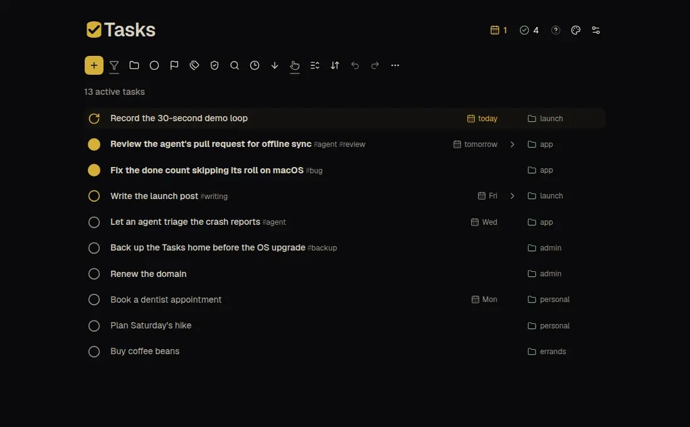

# Tasks

A calm, keyboard-first task list. Dump an idea in seconds, then shape it later. Every task is a plain JSON file, so you and your coding agents can all work on them.

**[Try it in your browser](https://tasks.soleone.xyz)** or [download the app](https://github.com/Soleone/tasks/releases/latest) for Windows, Linux, macOS or Android.



## What it's like

- **Capture without leaving the keyboard.** `C` opens a new task. Type `@work #urgent !fri` in the title and they turn into a category, a tag and a due date as you type.
- **Move work along in one key.** `Space` steps a task from open to in progress to done, `0`–`4` set its priority and `[` `]` its effort. `Shift+C` adds a subtask, `B` a blocker.
- **Ask the list one question.** `!` shows what is due today or late, `D` what you finished in the last day. `F` filters, `S` sorts, `/` searches.
- **Undo anything.** `Ctrl/⌘+Z` takes back your latest change, and the undo history is still there after a restart.
- **Learn it by doing.** Short quests teach Tasks one key at a time, on your own tasks, and wait whenever you want a break. `Ctrl/⌘+K` lists every shortcut and `?` opens the Learn panel.
- **Make it yours.** `Alt+T` flips through 25 built-in themes.

Every key has a mouse or touch path too. The full keymap is in [the client spec](spec/client/README.md).

## What a task holds

- **Status:** open, in progress, paused, done or canceled.
- **Priority:** P0 (most urgent) to P4.
- **Effort:** tiny to huge, in five steps.
- **Category and tags:** one `@category`, any number of `#tags`.
- **Due date:** `!fri`, `!tomorrow` or a date.
- **Notes:** a Markdown description.
- **Images:** paste screenshots straight in.
- **Structure:** subtasks under a parent, and blockers that must finish first.

## Made for working with agents

- **Hand a task to an agent.** `Ctrl/⌘+C` copies a task's title, description and tags, and `Ctrl/⌘+Shift+C` its newest image, ready to paste into a chat.
- **Capture from anywhere.** On desktop, a global hotkey brings Tasks forward or opens a new task over whatever you are doing.
- **Let agents work on the list.** `tasks-cli` works on the home the app opens, sharing its lock, so both can be open at once. `--home PATH` picks another home. Changes from the CLI show up in the open app without a restart, and every change goes through the same backend rules.

```bash
tasks-cli add 'Write the release notes @work #docs !fri'
tasks-cli list --status open --sort due
tasks-cli complete TASK_ID
```

Agents and your own clients can speak JSON lines instead, one request per line, with safe retries that are never applied twice:

```bash
printf '%s\n' '{"version":2,"command":"task.list","args":{"sort":"manual"}}' | \
  tasks-cli --stdio --client cli
```

For now, build the CLI from a checkout: `pnpm install && pnpm build:backend`, then run `node dist/backend/tasks-cli.js`. See [the CLI spec](spec/ecosystem/cli.md) and [the commands](spec/backend/commands.md).

## Your tasks are files

Everything Tasks keeps for one device lives in one folder, its Tasks home:

```text
<home>/settings.json   this device's preferences
<home>/sync/           the tasks: add only this folder to Syncthing
<home>/local/          caches, writer lock, recovery files and undo records; never synced
```

- **Sync across devices.** Each device has its own home, and [Syncthing](https://syncthing.net), free and self-hosted, shares only their `sync/` folders. [Syncing with Syncthing](docs/syncing.md) walks through setup, Android and what happens when two devices change the same task.
- **`local/` is not a throwaway cache.** It holds undo history, receipts and recovery files. Deleting it loses them, though the tasks themselves are safe in `sync/`.
- **Backups.** Close Tasks and the command line and copy the whole home. When you open a copy, the app asks to start a new history there, so a copy never inherits or wipes history silently. The old history is kept aside in `local/retired/`. A home moved as a whole on the same drive keeps its history once you confirm the move.

Coming from a version of Tasks before homes? [Moving a task folder into a home](docs/moving-to-a-home.md) takes three steps.

## Get it

- **In your browser:** [tasks.soleone.xyz](https://tasks.soleone.xyz) keeps your tasks in that browser only. Flip **Show example tasks**, bottom left, to look around.
- **Desktop and Android:** the [latest release](https://github.com/Soleone/tasks/releases/latest) has a Windows installer, a macOS disk image for Apple silicon, a Linux AppImage and an Android APK. The first launch asks you to create a Tasks home or open one you already have. The desktop apps update themselves.

## Development

A React app, the CLI and the JSON-lines interface share one TypeScript backend. The desktop and Android apps are Tauri shells with a bundled Node runtime, and the web version runs the same backend in a Web Worker.

```bash
corepack enable
pnpm install --frozen-lockfile
pnpm check && pnpm lint && pnpm test
pnpm dev:web
```

`pnpm dev:web` opens the app on a fresh copy of the sample tasks, so nothing touches your own. `pnpm dev:web:real` works on a copy of your real tasks and never writes back, and `pnpm dev:web --home PATH` opens a home you pick. `pnpm dev:native` runs the desktop app, `pnpm build:tauri` and `pnpm build:android` build the native apps, and `pnpm build:hosted` builds the web version. [The development guide](docs/development.md) covers each of these, plus validation, releases and signing. [PLAN.md](PLAN.md) has what is next and [GUIDELINES.md](GUIDELINES.md) the product principles.

## Documentation

- [Specification](spec/README.md): how the app works, in three layers (backend, ecosystem, client).
- [Syncing with Syncthing](docs/syncing.md): sharing tasks between devices and resolving conflicts.
- [Development](docs/development.md): setup, validation, native tooling and signing.
- [Plan](PLAN.md), [guidelines](GUIDELINES.md), [agent instructions](AGENTS.md).
- [Evidence](docs/evidence/README.md): dated reports, frozen.

## License

[MIT](LICENSE).
