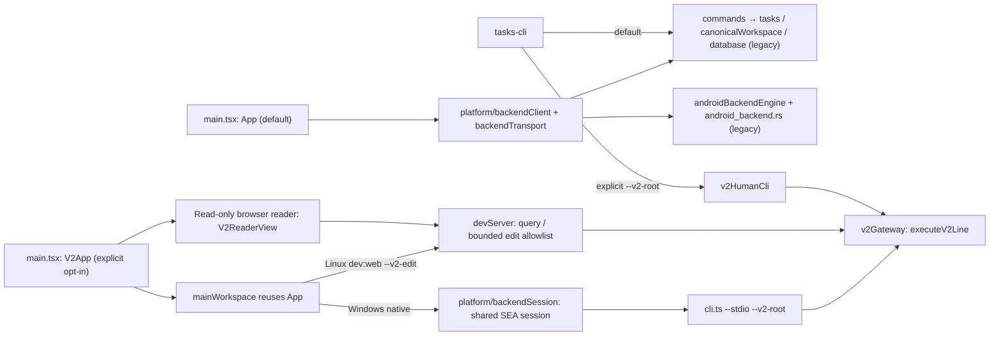
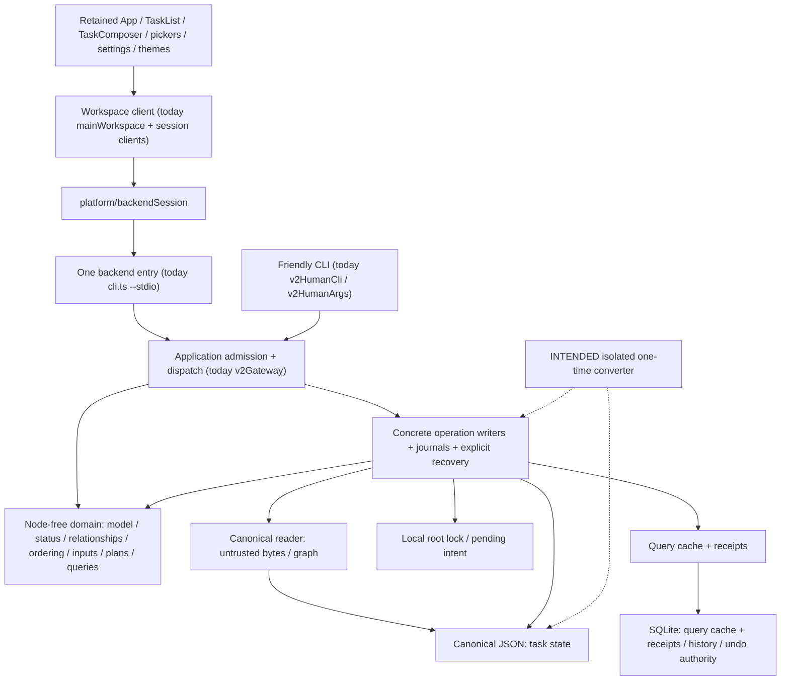

# Tasks specification

This is the single front door for Tasks contracts, rationale and evidence. [PLAN](../PLAN.md) alone owns direction, work order and stop/go gates; accepted behavior is not permission to implement the whole target or select personal data. Physical `spec/v2/` promotion waits for approved `dvs` cutover.

Proposal reasoning is not authoritative; accepted rationale lives in each page's Rationale section.

## Status and precedence

| Label | Meaning |
| --- | --- |
| **Implemented** | Code/tests implement the stated route; [current support](../docs/support.md) records platform/client availability, not full native acceptance. |
| **Accepted target** | Owner-accepted contract with bounded implementation; unimplemented rules remain targets, not an execution queue. |
| **Legacy default** | Implemented default behavior, scheduled for removal at `dvs`; not replacement authority except explicitly inherited rules. |
| **Undecided** | Owner gate in PLAN, never a specification MUST. |
| **Historical evidence** | Dated observations/counts, not requirements or present acceptance. |

Precedence by responsibility (not an implementation queue):

```text
PLAN: direction / gates → recorded owner decisions → spec/v2: accepted behavior
                                                       ↓ explicit inheritance only
                                                  root queries / CLI rules
```

The retained UI contract governs interaction; support reports what runs, code/tests establish implementation facts, and history supplies evidence only.

| Conflict | Resolution |
| --- | --- |
| C1: Spec differs from a later recorded owner decision | Correct the spec and cite that decision, rather than restore superseded behavior. |
| C2: Spec and code differ without a decision | Report a defect or open question; do not relabel unsupported behavior as passing. |
| C3: Replacement and root specs differ on a replacement question | `spec/v2/` wins; root rules apply only where explicitly inherited. |
| C4: Support and spec differ on availability | Support owns availability; correct it if code contradicts its claim. |
| C5: Rationale/history reads like a requirement | It has no independent force; reword it and retain accepted rules in their owning contract. |
| C6: Accepted rule is unimplemented | Keep the target label; implement only an authorized family. |
| C7: Proposal is undecided | Keep it out of normative spec text and in PLAN's owner gates. |

## Current routes (implemented; acceptance is route-specific)



Unflagged app/backend/CLI remain legacy. The selected Windows route has a smaller proven command subset than Linux; browser checks do not establish native parity. Latest owned Windows launches stopped before an observed main WebView; `100` remains paused, owner dogfood has zero sessions, and cutover/publication stay gated in PLAN.

## Intended single runtime after `dvs` (NOT implemented)



These responsibilities exist today, but the single default route, responsibility-based production names and converter isolation do not. The gateway/control/copy path still imports migration support. PLAN requires removing legacy/workbench routing at cutover, not permanent parallel products; persisted schema/protocol names remain contracts. SQLite authority is not wholly disposable: rebuild by re-observing files, never by deleting receipts/history.

## Module rules

These express the shared command-path and concrete-boundary direction in [GUIDELINES](../GUIDELINES.md) and PLAN; they do not authorize a new abstraction or enforcement project.

| Rule | Boundary / current qualification |
| --- | --- |
| R1 | Domain rules have no runtime filesystem/SQLite/storage imports; type-only storage contracts are allowed (`v2Queries`, `v2DoctorPlan`). |
| R2 | `executeV2Line` is the replacement dispatcher shared by backend entry, dev bridge and friendly CLI. |
| R3 | Each operation family owns its safety-specific writer/journal/recovery parsing; copy/migration coupling remains until converter isolation. |
| R4 | UI/platform consumers use Node-free backend contracts/rules, not filesystem or SQLite implementations. |
| R5 | Platform code owns backend sessions; current `V2App` native confirmation constructs a shared session as a temporary exception. |
| R6 | **Intended, not implemented:** only the isolated converter entry imports legacy shapes/migration support. |
| R7 | Stored serialization, table/journal tags and root/cache/profile bindings are contracts, not cosmetic product-version names to rewrite. |

## Specification map

| Pages | Status / ownership |
| --- | --- |
| [Replacement overview](v2/overview.md) | Accepted target and bounded implementation index. |
| [Model](v2/model.md), [protocol/queries/CLI](v2/protocol.md), [mutations](v2/mutations.md), [ordering](v2/ordering.md), [storage/recovery](v2/storage.md) | Accepted replacement contracts; route/evidence limits remain explicit. |
| [Migration](v2/migration.md) | Accepted conversion contract; disposable Linux rehearsal does not authorize personal conversion or native acceptance. |
| [Replacement conformance](v2/conformance.md) | Bounded evidence and historical milestones, not full target/native acceptance. |
| [UI overview](ui/overview.md), [home list](ui/home-list.md), [capture/edit](ui/capture-edit.md) | Retained main-client interaction contract; selected-route gaps are in support. |
| [Root model](model.md), [storage](storage.md), [protocol](protocol.md), [mutations](mutations.md) | Legacy implemented default; removed at `dvs`. |
| [Root queries](queries.md), [CLI](cli.md) | Legacy default plus rules explicitly inherited by [replacement protocol](v2/protocol.md#queries-and-cli); consolidate at `dvs`. |
| [Sources](sources.md), [root conformance](conformance.md) | Legacy registry behavior / evidence; removed at `dvs`, no replacement source registry. |

## Legacy-default format versions

| Area | Current version | Meaning |
| --- | --- | --- |
| Canonical workspace, task, and order JSON | `formatVersion: 1` | Durable legacy task state and workspace identity. |
| Local SQLite cache | schema version 6 | Query cache plus local history, receipts and recovery authority; not wholly disposable. |
| JSON-lines command protocol | `version: 1` | Legacy request/response transport, not a task-file format. |
| Workspace cache snapshot | `formatVersion: 1` | Task/classification/relation/activity/receipt snapshot, not the full database or sync folder. |
| Portable task export | `tasks.tasks-export`, version 2 | Readable projection, not canonical schema 2. |

Setup and keyboard help: [usage guide](../docs/usage-guide.md). Commands/validation: [development](../docs/development.md). Operational legacy recovery: [canonical workspace guide](../docs/canonical-workspace.md). This is Tasks' contract, not a universal-standard or independent-interoperability claim.
